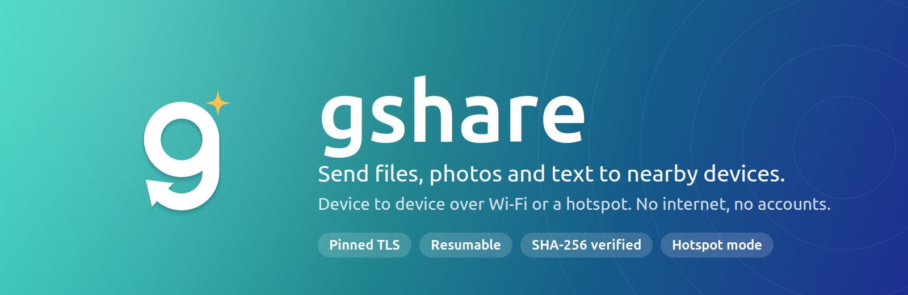
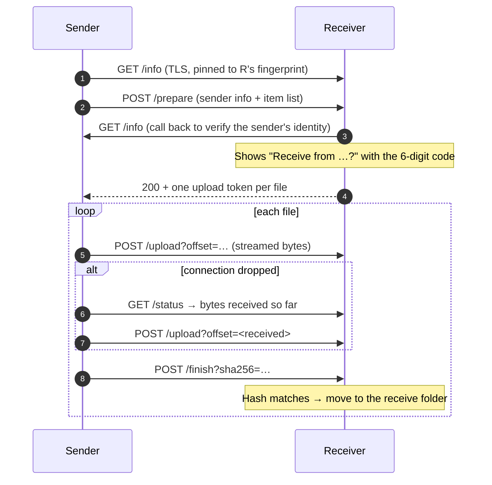

<p align="center">
  
</p>

<h1 align="center">gshare</h1>

<p align="center">
  <b>Share files, photos, videos and text between nearby phones and computers,<br>
  directly device to device. No internet, no accounts, no cloud.</b>
</p>

<p align="center">
  
  
  
  
  
  <a href="https://github.com/Al-Mahamud/gshare/releases"></a>
  <a href="LICENSE"></a>
</p>

---

gshare turns every device into both a small HTTPS server and a client. Open it on two devices on the same Wi-Fi
and they find each other automatically. Pick what to send, tap the other device, and the receiver accepts.
The files travel straight between the two devices over an encrypted connection.

No shared Wi-Fi? One Android phone can start a **hotspot from inside the app** and show a QR code that the other
device scans with its camera to join.

## Features

| | |
|---|---|
| **📡 Finds devices on its own** | UDP multicast, mDNS (Bonjour/NSD) and a scan of the local subnet run together. You can also scan a QR code or type an IP address. |
| **🔐 Encrypted and pinned** | Each device creates its own certificate on first launch, and its fingerprint *is* the device ID. Every connection is pinned to that fingerprint, so another device can't pretend to be it. |
| **🔢 Verification code** | The sender and receiver both show the same 6-digit code, so you can confirm you're talking to the right device. |
| **✅ Accept or decline** | Nothing arrives without the receiver's consent. Mark a device as *trusted* to accept its transfers automatically next time. |
| **🔁 Resumes after drops** | Files are streamed in chunks. If the connection breaks, the sender asks how much arrived and continues from there, up to 4 attempts with backoff. |
| **🧮 Verified with SHA-256** | The receiver hashes every file and compares it with the sender's hash before saving. A corrupted file is re-sent. |
| **📶 Hotspot mode** | Android starts a local-only hotspot in the app and shows a Wi-Fi QR code, so phones can share with no router at all. |
| **📲 Share sheet** | "Share → gshare" from any Android app, for files, photos or text. |
| **🖼️ Saves where you expect** | Received photos and videos go to the gallery and other files to `Downloads/gshare`. Received text has a *Copy* button. |
| **🙋 Your name** | On first launch you choose the name other devices see. You can change it later in Settings. |
| **🔋 Works in the background** | An Android foreground service keeps a transfer running while the app is in the background. |
| **🌗 Light and dark** | Material 3 theme that follows the system's light or dark setting. |

## How a transfer works



Both devices run the same code. The full API, status codes and limits are in [`docs/PROTOCOL.md`](docs/PROTOCOL.md).

## Security model

- **No certificate authority.** On first launch each device creates an RSA-2048 key and a self-signed certificate.
  The device ID is the SHA-256 fingerprint of that certificate.
- **Certificate pinning.** A client accepts a peer's certificate only if its fingerprint equals the ID it expects.
  During discovery the ID from `/info` is checked against the TLS certificate that served it.
- **Sender verification.** Before asking the user, the receiver connects back to the sender and checks its
  certificate. If that fails, the request is marked **unverified** and can never be auto-accepted.
- **Consent and short-lived tokens.** Uploads need a random token per file, issued only after the receiver accepts.
- **Safe file handling.** Incoming file names are reduced to a base name and cleaned of illegal characters.
  Files are written to a `.part` file first and moved into place only after the SHA-256 check passes.
- **Local only.** gshare never contacts a server on the internet.

## Platform support

The app is written for Android, iOS, Windows, macOS and Linux from a single Flutter codebase.
**Android is the platform that currently builds.** The other platforms are implemented in code
but haven't been built yet.

| | Android | iOS | Windows | macOS | Linux |
|---|:---:|:---:|:---:|:---:|:---:|
| Build status | ✅ builds | not built yet | not built yet | not built yet | not built yet |
| Multicast discovery | ✅ | – ¹ | ✅ | ✅ | ✅ |
| mDNS discovery | ✅ | ✅ | ✅ | ✅ | – |
| Subnet scan, QR, manual IP | ✅ | ✅ | ✅ (no QR scan) | ✅ | ✅ (no QR scan) |
| Host a hotspot in the app | ✅ Android 8+ | system hotspot | system hotspot | – | – |
| Background transfers | foreground service | while open | ✅ | ✅ | ✅ |

¹ Needs Apple's multicast networking entitlement.

## Getting started

### Install on Android

Download an APK from the [**Releases**](https://github.com/Al-Mahamud/gshare/releases) page, or build one yourself
(see below). Pick the file that matches your phone:

| File | For |
|---|---|
| `gshare-<version>-arm64-v8a.apk` | Almost every Android phone from the last several years **(start here)** |
| `gshare-<version>-armeabi-v7a.apk` | Older 32-bit phones |
| `gshare-<version>-universal.apk` | Any phone, if you're unsure (larger download) |

Android 7.0 (API 24) or newer is required. Allow *Install unknown apps* when Android asks.
Each release lists SHA-256 checksums in `SHA256SUMS.txt` if you want to verify a download.

### Build from source

Requirements: Flutter 3.47+ (Dart 3.13), JDK 17 and the Android SDK.

```bash
git clone https://github.com/Al-Mahamud/gshare.git
cd gshare
flutter pub get

flutter test                                   # unit and widget tests
flutter build apk --release --split-per-abi   # APKs land in build/app/outputs/flutter-apk/
```

For iOS, Windows, macOS and Linux, first generate the missing platform folders. This keeps every existing file:

```bash
bash tool/setup.sh                                          # macOS / Linux
powershell -ExecutionPolicy Bypass -File tool\setup.ps1     # Windows
```

iOS and macOS builds need a Mac with Xcode. On macOS, `setup.sh` also adds the required `Info.plist` privacy keys.

## Using gshare

1. **Choose your name** on first launch. This is what other devices see.
2. **Send:** pick *Files*, *Photos & videos* or *Text*, then tap a device under *Nearby devices*.
3. **Receive:** keep gshare open. When a request arrives, compare the 6-digit code and tap **Accept**.
4. **No Wi-Fi?** Tap the hotspot icon at the top. Start a hotspot on one Android phone and scan its QR code with
   the other device's camera, then tap *Scan for devices*.
5. **Can't see a device?** Open the other device's *Receive* tab and scan its QR code, or type the address shown there.

## Project structure

```
lib/
├── main.dart, app.dart          startup, theme, first-launch name screen gate
├── core/                        models, identity & TLS, settings, network helpers, pinned HTTP client
├── services/
│   ├── server.dart              HTTPS routes
│   ├── receive_manager.dart     accept flow, upload / resume / verify, saving to gallery or Downloads
│   ├── send_manager.dart        prepare → upload → finish, retries, cancel
│   ├── discovery/               multicast, mDNS, subnet scan
│   └── app_services.dart        wiring
├── platform/native_bridge.dart  Android channel: hotspot, multicast lock, foreground service, share sheet
└── ui/                          Send, Receive, Transfers, Settings, Hotspot, QR scanner, name setup
android/app/src/main/            AndroidManifest.xml, MainActivity.kt, TransferService.kt
docs/                            PROTOCOL.md (wire protocol), PLAN.md (roadmap)
tool/                            setup scripts, Info.plist patcher, make_icon.py (draws the app icon)
```

| Package | Used for |
|---|---|
| `basic_utils`, `crypto` | Certificate generation, SHA-256 |
| `nsd` | mDNS advertising and browsing |
| `file_picker`, `mobile_scanner`, `qr_flutter` | Picking files, scanning and showing QR codes |
| `gal`, `open_filex`, `path_provider` | Saving to the gallery, opening received files, folders |
| `permission_handler`, `shared_preferences` | Runtime permissions, settings and trusted devices |

## Testing

```bash
flutter analyze   # no issues
flutter test      # 12 tests
```

The tests cover verification codes, file-name sanitising (no path traversal), item ID validation, Wi-Fi QR escaping,
transfer JSON round-trips, size formatting, saving the user's name, and the first-launch name screen.

## Roadmap

- [ ] Test across devices: Android ↔ iOS and Android ↔ Windows on home Wi-Fi, office Wi-Fi and a hotspot
- [ ] Build and release iOS, Windows, macOS and Linux
- [ ] Send several files in parallel
- [ ] Rate limiting for `/prepare` and an optional PIN for untrusted devices
- [ ] Keep transfer history across restarts
- [ ] iOS share extension; desktop drag and drop and a choice of receive folder
- [ ] Join a hotspot in the app on Android (`WifiNetworkSpecifier`) instead of using the camera

See [`docs/PLAN.md`](docs/PLAN.md) for the full plan.

## Known limitations

- Many guest and office networks block device-to-device traffic (*client isolation*). Use the hotspot instead.
- On Android, received files stay in the app folder and are also copied to the gallery or `Downloads/gshare`.
- Transfer history is kept in memory only.
- Windows asks to allow gshare through the firewall on first launch. Allow it on private networks.
- Release builds are currently signed with the debug key, which is fine for sideloading but not for the Play Store.

## License

Released under the [MIT License](LICENSE).

## Author

**Al Mahamud** · [@Al-Mahamud](https://github.com/Al-Mahamud)
